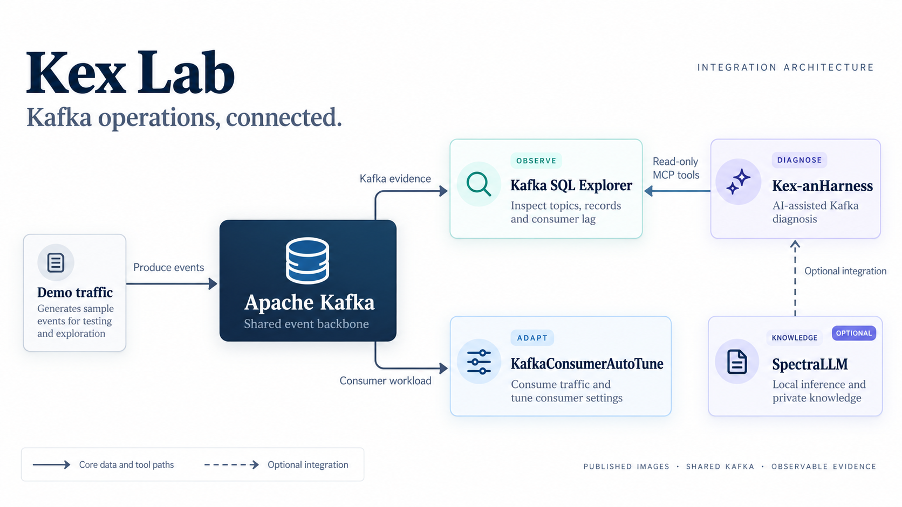

# End-to-end scenario

This scenario demonstrates the operational chain shared by three of the four projects without duplicating their source trees.



Traffic flows into Kafka, AutoTune consumes it, and Explorer exposes the broker
as read-only MCP evidence for Kex-anHarness. The dashed SpectraLLM path is an
optional integration requiring explicit configuration.

## Run

Run `make setup` and review `.env`, including a provider key if you want the
Agent reasoning step. The lightweight path starts four services without Spectra:

```bash
make demo-lite
```

Compose first runs the one-shot `kafka-init` service. It creates `demo.app.topic` and `demo.app.topic.dlt` (six partitions by default) and seeds `demo.app.topic` with 500 deterministic JSON records by default. Kafka-dependent services then start after successful initialization. Values can be changed through `KEX_LAB_TOPIC`, `KEX_LAB_DLT_TOPIC`, `KEX_LAB_PARTITIONS` and `KEX_LAB_MESSAGES`.

AutoTune is launched with its `dev` profile and H2 persistence, so the Lab does not require the Oracle XE stack merely to demonstrate Kafka consumption and tuning. Its image normally waits for Oracle in its entrypoint; the Lab overrides that entrypoint for this H2 evaluation profile.

## Verify each injection

`SCENARIO=basic make scenario-assert` captures offsets before and after one
traffic run and requires exactly the configured number of new records across
all partitions. `SCENARIO=dlt make scenario-assert` additionally finds a poison
record among the newly appended records. Existing backlog or historical poison
records cannot satisfy these checks. Run with no other producer writing to the
same topic; concurrent writes fail the exact-count assertion.

Use `make health PROFILE=demo` to check this Kafka/Explorer/Agent/AutoTune stack.
Use `make health PROFILE=full` when Spectra is also running.

The guided lightweight command records the basic scenario assertion and writes
`reports/latest.md` and `reports/latest.json`. A starting Docker budget is
4 CPUs, 8 GB RAM and 10 GB free disk; actual resource use depends on traffic and
host configuration. Use `make demo` for the full published stack with Spectra.

## Observe

Open:

- Explorer: http://localhost:8080
- Agent: http://localhost:8081
- AutoTune: http://localhost:8082/dashboard

In AutoTune, observe throughput, lag and optimizer state. In Explorer, inspect `demo.app.topic`, its records and consumer groups.

Then ask the Agent:

> Inspect demo.app.topic and tell me whether its consumers are keeping up. Base the answer on the Kafka tools.

The expected proof is a chain of evidence rather than a predetermined prose answer: the Agent should invoke Explorer's MCP tools, Explorer should read the same Kafka broker, and the resulting state should correspond to the consumer activity visible in AutoTune.

For explicit topic rules, a lag baseline that persists after restarting
Explorer, and declared DLT lineage, use the optional
[Kafka operational review profile](OPERATIONAL-REVIEWS.md) with compatible
images. Those capabilities are not prerequisites for the base demo.

## Change the load

```bash
KEX_LAB_MESSAGES=5000 make traffic
```

The `traffic` service uses the same `scripts/kafka-init.sh` implementation as Compose startup, so this adds another 5,000 deterministic records without maintaining a separate producer path. This gives the optimizer a larger backlog to work through. Compare consumer lag in Explorer with throughput and tuning interventions in AutoTune.

## SpectraLLM

SpectraLLM remains optional because its first boot downloads several GB of model weights. It is complementary in two roles already supported by the upstream projects: private/local LLM inference and private domain knowledge/RAG. Run it with:

```bash
sh scripts/evaluate.sh spectra
```

`make demo` starts the full published stack, including SpectraLLM. For the
traffic-to-diagnosis path without Spectra, use `make demo-basic`, then `make wait`.
The separate upstream evaluation command above uses its own infrastructure;
stop the Lab first to avoid port collisions.

## Stop

```bash
make demo-down
```

Use `make reset` for the core stack and volumes.
